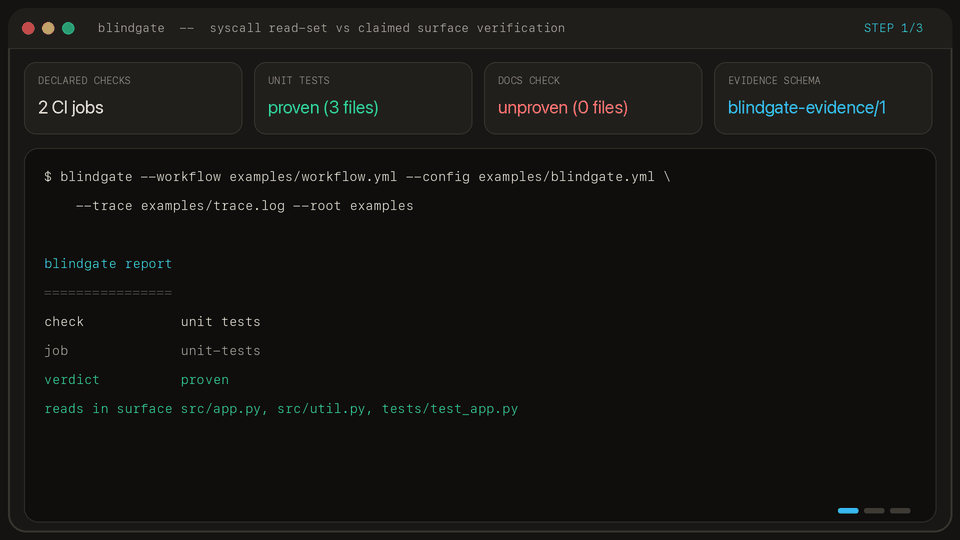
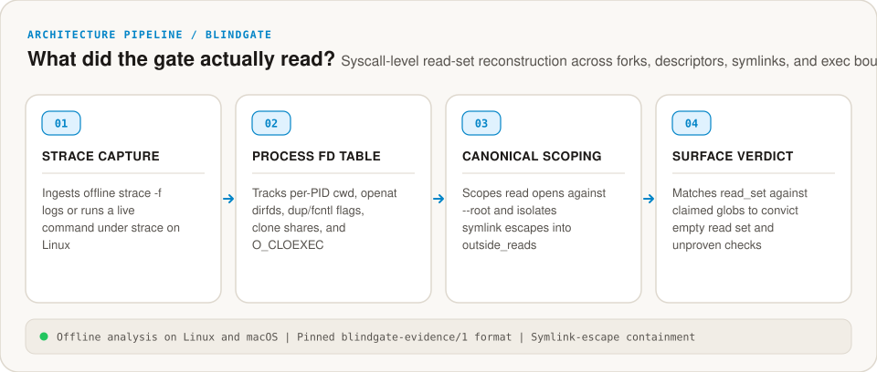
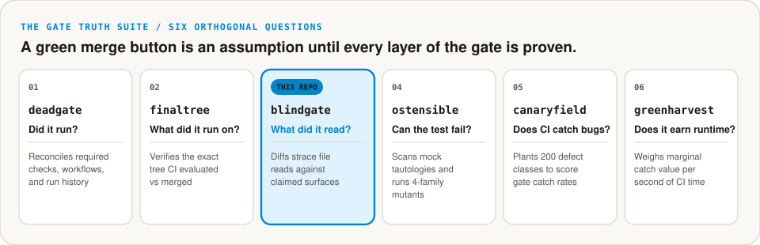

<p align="center">
  <a href="https://github.com/david-engelmann/blindgate">
    <picture>
      <source media="(prefers-color-scheme: dark)" srcset="https://raw.githubusercontent.com/david-engelmann/blindgate/main/docs/media/blindgate-lockup-dark.svg">
      
    </picture>
  </a>
</p>

<h3 align="center">Trace what a CI gate actually opened at the syscall level and diff it against its claimed surface.</h3>

<p align="center">A CI check named <code>docs-check</code> or <code>migration-lint</code> can exit <code>0</code> for months while reading zero files in the folder it claims to guard. <code>blindgate</code> reconstructs the exact file read set from Linux <code>strace</code> logs across forked processes, relative <code>openat</code> descriptors, and symlinks, convicting any check whose reads miss its claimed surface.</p>

<p align="center">
  <a href="https://github.com/david-engelmann/blindgate/blob/main/docs/GUIDE.md"><b>Operator Guide</b></a> |
  <a href="https://david-engelmann.github.io/blindgate/">Published Docs</a> |
  <a href="https://github.com/david-engelmann/blindgate/tree/main/examples">Examples</a> |
  <a href="https://github.com/david-engelmann/blindgate/blob/main/docs/ARCHITECTURE.md">Architecture</a> |
  <a href="https://github.com/david-engelmann/blindgate/blob/main/docs/FORMATS.md">Wire Formats</a> |
  <a href="https://github.com/david-engelmann/blindgate/blob/main/docs/COMPARISON.md">Comparison</a> |
  <a href="https://github.com/david-engelmann/blindgate/blob/main/docs/FAQ.md">FAQ</a> |
  <a href="https://github.com/david-engelmann/blindgate/releases">Releases</a>
</p>

<p align="center">
  <a href="https://github.com/david-engelmann/blindgate/actions/workflows/ci.yml"></a>
  <a href="https://david-engelmann.github.io/blindgate/"></a>
  <a href="https://github.com/david-engelmann/blindgate/blob/main/Cargo.toml"></a>
  <a href="https://github.com/david-engelmann/blindgate/blob/main/LICENSE"></a>
</p>

<p align="center">
  
</p>

<p align="center"><sub>Every terminal line above comes from running the blindgate release binary against examples/.</sub></p>

## What this is

Blindgate captures what a CI job actually opened at the filesystem and process level and pairs that read set with the surface the check claims to cover. A gate whose read set never touches its surface is reported as unproven, with the trace attached, and an empty read set is named outright. It is used by handing it a workflow file, a config that declares each check and the surface it claims, and either a trace recorded earlier or a command to run under strace. The boundary with its siblings is one sentence. Deadgate asks whether it ran, finaltree asks what it ran on, blindgate asks what it read.

<p align="center">
  <picture>
    <source media="(prefers-color-scheme: dark)" srcset="https://raw.githubusercontent.com/david-engelmann/blindgate/main/docs/media/how-it-works-dark.svg">
    
  </picture>
</p>

## Install

Install a prebuilt binary on Linux or macOS (`x86_64` and `aarch64`) with the checksum-verifying installer script.

```sh
curl -fsSL https://raw.githubusercontent.com/david-engelmann/blindgate/main/install.sh | sh
export PATH="$HOME/.local/bin:$PATH"
```

Or install via `cargo-binstall` or from source with Cargo (Rust 1.87 or newer).

```sh
cargo binstall --git https://github.com/david-engelmann/blindgate blindgate
cargo install --git https://github.com/david-engelmann/blindgate --locked
```

From a checkout of this repo, `cargo build --release --locked` leaves the release binary at `target/release/blindgate`.

## Quickstart

The example run judges `examples/trace.log` against the two checks declared in `examples/blindgate.yml`, scoped canonically to `examples/`.

```sh
blindgate --workflow examples/workflow.yml --config examples/blindgate.yml --trace examples/trace.log --root examples
```

It prints the deterministic report standing in `examples/report.txt`, proving `unit tests` (`src/app.py`, `src/util.py`, `tests/test_app.py`) and convicting `docs check` as `unproven` (`claimed surface` `docs/*.md`, `reads in surface` `none`).

```
blindgate report
================

check            unit tests
job              unit-tests
verdict          proven
claimed surface
    src/**
    tests/**
read set
    notes.txt
    src/app.py
    src/util.py
    tests/test_app.py
reads in surface
    src/app.py
    src/util.py
    tests/test_app.py

check            docs check
job              docs-check
verdict          unproven
claimed surface
    docs/*.md
read set
    notes.txt
    src/app.py
    src/util.py
    tests/test_app.py
reads in surface
    none
```

Pass `--json` on any invocation to render the sorted-key JSON document (`examples/report.json`), `--trace-for JOB=PATH` to override the trace for a specific job, or `--run <command...>` on Linux to capture a live run under `strace`.

## Recording Traces in CI

Live capture (`--run`) requires Linux `strace`, whereas offline trace inspection (`--trace` and `--trace-for`) runs on both Linux and macOS. When recording a trace file inside a Linux CI job for offline analysis, pass `-f` and the full descriptor and process syscall set so child processes and relative `openat` descriptors resolve accurately.

```sh
strace -f -e trace=open,openat,openat2,chdir,fchdir,close,close_range,dup,dup2,dup3,fcntl,clone,fork,vfork,clone3,execve,execveat -o trace.log -- pytest -q
```

## Benchmarks and Verification

Run the full local gate (matching Linux CI).

```sh
cargo test --locked
cargo fmt --check
cargo clippy --offline --all-targets
cargo package --locked
```

Measured with the `--release` binary on synthetic multi-process `strace` logs.

| Workload | Input shape | Mean elapsed | Throughput |
| --- | --- | --- | --- |
| `examples/` surface audit | `2` workflow jobs, `examples/trace.log`, canonical `--root` scoping | `40.0 ms` | Instant CLI check |
| `20k`-syscall `strace -f` log | `20,000` `openat`/`close`/`clone` lines (`841 KB`) across `8` PIDs and `50` files | `1.81 s` | `11,040 syscalls/s` (including OS `canonicalize`) |

## The Gate Truth Suite

<p align="center">
  <picture>
    <source media="(prefers-color-scheme: dark)" srcset="https://raw.githubusercontent.com/david-engelmann/blindgate/main/docs/media/gate-truth-arc-dark.svg">
    
  </picture>
</p>

| Tool | Question answered | Primary evidence |
| --- | --- | --- |
| [deadgate](https://github.com/david-engelmann/deadgate) | Did the required check actually run? | Branch protection, workflow YAML, and job history |
| [finaltree](https://github.com/david-engelmann/finaltree) | What tree did CI actually evaluate? | Commit and tree lineage across merge queues |
| [blindgate](https://github.com/david-engelmann/blindgate) | What files did the gate actually read? | Linux `strace` descriptor and path reconstruction |
| [ostensible](https://github.com/david-engelmann/ostensible) | Can the test actually fail? | Static tautology scan and 4-family `pytest` mutants |
| [canaryfield](https://github.com/david-engelmann/canaryfield) | Does the harness catch planted defects? | 200 seeded Python defect classes across real gates |
| [greenharvest](https://github.com/david-engelmann/greenharvest) | Which tests earn their CI runtime? | Marginal defect-catch value per second of execution |

## Documentation

| If you want to... | Read |
| --- | --- |
| Browse the searchable handbook with diagrams | [Published documentation](https://david-engelmann.github.io/blindgate/) |
| Install, configure CI workflows, and run day-two operations | [Operator Guide](https://github.com/david-engelmann/blindgate/blob/main/docs/GUIDE.md) |
| Understand parser bounds, engine phases, and containment invariants | [Architecture](https://github.com/david-engelmann/blindgate/blob/main/docs/ARCHITECTURE.md) |
| Integrate JSON or text schemas into downstream tooling | [Wire Formats](https://github.com/david-engelmann/blindgate/blob/main/docs/FORMATS.md) |
| Compare `blindgate` against existing linters, coverage, and mutators | [Comparison](https://github.com/david-engelmann/blindgate/blob/main/docs/COMPARISON.md) and [FAQ](https://github.com/david-engelmann/blindgate/blob/main/docs/FAQ.md) |
| Review threat boundaries, vulnerability reporting, and contribution gates | [Security Policy](https://github.com/david-engelmann/blindgate/blob/main/SECURITY.md) and [Contributing](https://github.com/david-engelmann/blindgate/blob/main/CONTRIBUTING.md) |

## Status

The local seed is done and the repo stands on GitHub. The 403 refusals the seed week recorded no longer hold, and work lands through pull requests. The contract in CONTRACT.md holds the obligations for this repo. AGENTS.md stands in this repo, the canonical template of the program with this repo's annex below its marked line.

The tool is the Rust crate alone, and the Python package it replaces is retired. The crate opened as slice 1 with the reader model, the line classification, the canonical scoping, and the openat reading, and the port slices that followed carried the parse entry whole, the file reading entries and the live capture, the config and workflow and analysis and report modules, and the evidence format those results imply. The command line stands in the crate's binary shell, scanning its arguments under the model the contract states, and the example reports under examples regenerate byte identical on every head. The gate is cargo test, and the suite carries the conformance batteries the Python package produced over its own recordings beside the crate's own tests.

Closed rounds stand at 30 of 100. Pinned formats stand at blindgate-evidence/1.

## Licence

MIT. See LICENSE.
