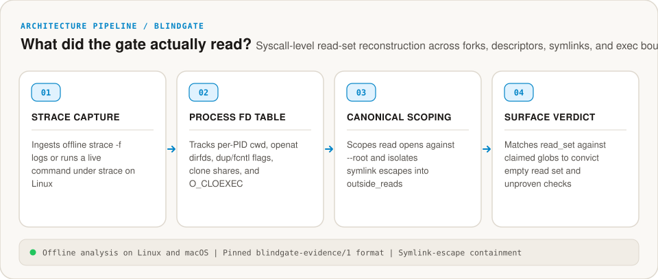
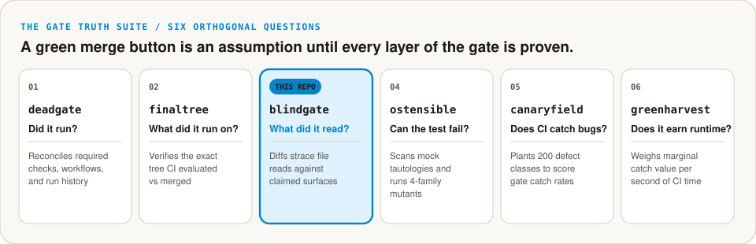

# Blindgate Architecture

Blindgate asks what a CI gate actually opened for reading while it executed. Implemented as a zero-dependency pure-Rust library and CLI (`src/`), Blindgate parses Linux `strace` syscall logs and workflows offline on Linux and macOS (or captures live commands under `strace` on Linux) and convicts gates whose read set never touches their claimed surface.

  <picture>
    <source media="(prefers-color-scheme: dark)" srcset="https://raw.githubusercontent.com/david-engelmann/blindgate/main/docs/media/how-it-works-dark.svg">
    
  </picture>

## Pipeline Stages

### 1. Bounded Workflow and Config Readers (`src/yaml.rs`, `src/value.rs`, `src/config.rs`, `src/workflow.rs`)

Blindgate parses GitHub Actions workflow YAML files and `blindgate.yml` / `.json` check declarations with its own PyYAML-arbitrated, nesting-bounded pure-Rust readers. Every configured check must reference a real job identifier under `jobs` in `--workflow` and declare a non-empty list of claimed surface patterns.

### 2. Syscall Line Classifier and Per-Process State Machine (`src/classify.rs`, `src/parse.rs`)

Linux test runners fork worker pools, `dup2` directory descriptors, change directories per worker, and mark descriptors `O_CLOEXEC` across `execve`. Blindgate tracks state per PID across the complete process and descriptor lifecycle

- **Read-bearing opens** `open`, `openat`, and `openat2` returning a non-negative descriptor with `O_RDONLY` or `O_RDWR` (excluding metadata-only `O_PATH` and `O_DIRECTORY` opens from `read_set` while still tracking directory descriptors for future relative `openat` calls).
- **Working directories and descriptors** `chdir`, `fchdir`, `dup`, `dup2`, `dup3`, `fcntl` (`F_DUPFD`, `F_DUPFD_CLOEXEC`, `F_SETFD`), `close`, and `close_range`.
- **Process creation and `exec`** `clone`, `fork`, `vfork`, and `clone3` share or copy `CLONE_FILES` and `CLONE_FS` tables strictly according to the printed flags, and successful `execve` / `execveat` calls close descriptors marked close-on-exec.

### 3. Lexical Settlement and Canonical `--root` Containment (`src/scope.rs`)

Every opened path is resolved against the calling PID's current working directory or `dirfd`. Paths whose written form already lies outside `--root` (such as `/etc/ld.so.cache` or `/usr/lib/...`) are dropped unnamed. Paths resolving canonically inside `--root` enter `read_set`, whereas paths whose written form or inside-opened `dirfd` started inside `--root` and escaped outside `--root` via symlink resolution are isolated into `outside_reads` (`S3-1`, `S5-2`, `FIX4-2`) and never satisfy a claimed surface.

### 4. Surface Matching and `blindgate-evidence/1` Emission (`src/analysis.rs`, `src/report.rs`)

Entries containing `*`, `?`, or `[` match via whole-string `fnmatch` semantics, while plain entries match exact paths or directory prefixes. Each check receives verdict `empty read set` (`read_set` empty), `unproven` (`read_set` non-empty with zero matches in `surface`), or `proven` (at least one read inside `surface`).

  <picture>
    <source media="(prefers-color-scheme: dark)" srcset="https://raw.githubusercontent.com/david-engelmann/blindgate/main/docs/media/gate-truth-arc-dark.svg">
    
  </picture>

